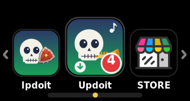
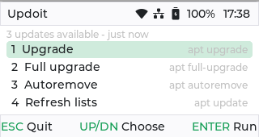
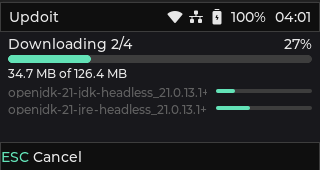
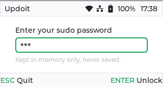
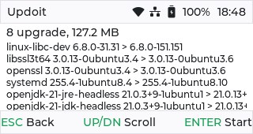
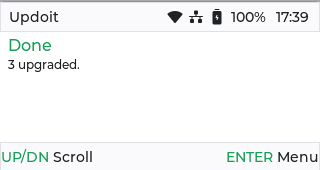

<p align="center">
  
  
  
</p>

<div align="center">
    <h1>Updoit for CardputerZero</h1>
    <p>apt updates from the CardputerZero launcher, with parallel downloads.</p>
</div>

## What it does

- **apt update, apt dist-upgrade -d, apt upgrade, apt dist-upgrade, apt autoremove,
  apt clean** from a keyboard-driven 320x170 UI, run as the matching `apt-get` commands.
  `-d` downloads everything now and installs nothing, so a later upgrade needs no network.
- **Each menu row shows what it would do**: package counts, the time of the last update and
  the size of the package cache, cached in `/var/lib/updoit-for-cardputer-zero/status`.
- **Confirm first**: shows what will be upgraded, installed, removed or kept back, and the
  download size, before anything changes.
- **Parallel downloads** with `aria2c` (4 files at once, 2 connections each), with overall
  and per-file progress. Downloads finish and are verified before apt installs anything, so a
  dropped connection leaves the system untouched. Cancelled downloads resume next time.
- **Install progress** from apt's own status output.
- **Daily background check** like DietPi's `CONFIG_CHECK_APT_UPDATES`: a systemd timer counts
  pending upgrades, and the menu shows the result instantly.
- **Red badge on the launcher icon** with the number of pending updates (1-9, then 9+).
- **sudo password** asked on launch (skipped when running as root or with passwordless sudo),
  kept in memory only and never written anywhere.

See [docs/REQUIREMENTS.md](docs/REQUIREMENTS.md) for scope and planned features (battery
guard, reboot prompt, network check, auto-upgrade, pipelined download+install).

## Keys

| Page | Keys |
| --- | --- |
| Password | type, `Enter` unlock, `Backspace` delete, `Esc` quit |
| Menu | `Up`/`Down` or `W`/`S` choose (the list scrolls), `1`-`6` run directly, `Enter` run, `Esc` quit |
| Confirm | `Up`/`Down` scroll, `Enter` download + install, `Esc` back |
| Progress | `Esc` cancel (checking and downloading only; never mid-install) |
| Result | `Up`/`Down` scroll, `Enter`/`Esc` back to menu |

Hold `Esc` to quit from anywhere except during install. `Fn`+`H` shows help.

## How it works

1. **Plan** (as your user): `apt-get -s <verb>` for the list, `apt-get --print-uris <verb>`
   for URLs, sizes and hashes.
2. **Download** (as your user): `aria2c` fetches into `~/.cache/updoit/archives` with
   checksums. Progress is read from the files on disk, not aria2's console.
3. **Install** (as root): the files are moved into `/var/cache/apt/archives` (a rename on the
   same filesystem) and owned by root, then `apt-get <verb>` runs. apt re-checks every hash and
   reports `Need to get 0 B`. Status is read on fd 3; using `APT::Status-Fd=1` breaks maintainer
   scripts that print to stdout.
4. **Recount**: `/usr/lib/updoit-for-cardputer-zero/updoit-check --no-update` refreshes the menu's count.

The backend (`src/updater/`) is plain C++17 with no LVGL dependency, and runs on a worker
thread that the UI polls every 100 ms.

## Installed files

| Path | Purpose |
| --- | --- |
| `/usr/bin/updoit-for-cardputer-zero` | the app (started by the launcher) |
| `/usr/lib/updoit-for-cardputer-zero/updoit-check` | daily check script |
| `/usr/lib/updoit-for-cardputer-zero/updoit-cli` | headless driver, useful over SSH |
| `/lib/systemd/system/updoit-for-cardputer-zero-check.{service,timer}` | 10 min after boot, then daily |
| `/etc/updoit-for-cardputer-zero/updoit.conf` | `UPDOIT_CHECK_APT_UPDATES=0/1/2` (off / check only / auto, planned) |
| `/var/lib/updoit-for-cardputer-zero/status` | cached counts (upgrade, full-upgrade, autoremove) and last update time, written by the check; survives reboots |
| `/usr/share/updoit-for-cardputer-zero/icons/updoit-badge-*.png` | icon variants: no badge, 1-9, 9+ |
| `/usr/share/APPLaunch/share/images/updoit-for-cardputer-zero-live.png` | the icon the launcher shows; shipped as the no-badge variant, rewritten by the check |
| `/usr/lib/tmpfiles.d/updoit-for-cardputer-zero.conf` | ownership of the check's state dir, the live icon and the poke file (the service user itself is created by `postinst`) |

The badge works with the stock launcher, which watches its `applications/` folder. The daily
check runs as the unprivileged `updoit-for-cardputer-zero` user (app store rule), so its
tmpfiles.d entry gives that user the live icon and `applications/.updoit-for-cardputer-zero-poke`; the check
rewrites both in place. When the app recounts as root after an upgrade it also creates and
deletes a file there. The daily check can't run `apt-get update` as that user, so list
refreshes come from the app's Refresh, or from the OS `apt-daily.timer` once menu item 7
("Turn daily check on") is set. That item writes
`/etc/apt/apt.conf.d/99updoit-for-cardputer-zero` with
`APT::Periodic::Update-Package-Lists "1"` (or `"0"` to turn it off); it only refreshes the
lists, and never downloads or installs packages. The file is the user's apt setting, so
removing or purging Updoit leaves it in place. Updoit's `.desktop` file is never rewritten,
because the launcher orders apps by that file's modification time. Icons are rendered from
`assets/images/updoit-icon-skull.svg` with `scripts/render-icons.sh`.

Depends on `apt`, `aria2` and `sudo`.

## Testing without the GUI

```shell
updoit-cli download                   # fetch the full-upgrade set into apt's cache, install nothing
updoit-cli clean                      # free the apt package cache (no confirm step)
updoit-cli upgrade --plan-only        # show the plan, change nothing
updoit-cli upgrade                    # prompts for the sudo password, then asks to proceed
updoit-cli full-upgrade --yes --limit=500K
```

`UPDOIT_DOWNLOAD_LIMIT=500K` limits the app's download rate (aria2 syntax), for slow links or
for watching the progress screen.

Parser tests: `ctest --test-dir build/linux-x86-64 -C Debug`.

## Screenshots

| | |
| --- | --- |
|  |  |
| Launcher, with the pending-updates badge (mockup) | **Password**: asked once, kept in memory only |
|  |  |
| **Menu**: the apt command for each row, with package counts | **Confirm**: what will change, and the download size |
|  |  |
| **Download**: parallel, with per-file progress | **Done** |

The page screenshots come from the desktop simulator.
`screenshot/updoit-launcher-mockup.png` is a mockup, not a capture: it places the Updoit
icon on the launcher home screen using the carousel geometry from
[CardputerZero/launcher](https://github.com/CardputerZero/launcher)'s source. The Store icon
and carousel arrows in it are that project's assets (MIT, Copyright (c) 2026 M5Stack
Technology CO LTD). The launcher's top bar is left blank, and the titles use DejaVu Sans
Bold rather than the launcher's Montserrat.

## Status

Tested on an Ubuntu 24.04 amd64 host in the desktop simulator, as a sudo user with a password:
wrong/right password, upgrade with real packages, cancel and resume of downloads, autoremove,
refresh, light and dark themes. **Not yet tested on CardputerZero hardware.** Things to check
there: the device keyboard (shift and symbol layers for passwords), how the launcher starts
apps (as which user), and whether `aria2` is available for the device image.

## Build Options

Common CMake cache options:

| Option | Default | Description |
| --- | --- | --- |
| `USE_DESKTOP` | `ON` | Build SDL desktop simulator when `ON`; build embedded Linux target when `OFF`. |
| `APP_NAME` | `updoit-for-cardputer-zero` | Application name used by installed asset lookup. |
| `APP_ASSETS_ROOT` | empty | Optional runtime asset root. Expected layout includes `fonts/`, `images/`, etc. |
| `APP_CONFIG_FILE` | platform default | Optional config path. Defaults to `config/updoit-for-cardputer-zero.conf` for desktop builds and `/etc/updoit-for-cardputer-zero.conf` for device builds. |
| `APP_KEY_INPUT_DEVICE` | empty | Optional Linux evdev device path, e.g. `/dev/input/event0`. Empty means auto-scan `/dev/input/event*`. |
| `APP_FRAMEBUFFER_DEVICE` | `/dev/fb0` | Linux framebuffer device used by embedded builds when `APP_USE_DRM=OFF`. |
| `APP_USE_DRM` | `OFF` | Use LVGL's Linux DRM/KMS backend instead of fbdev for embedded builds. |
| `APP_DRM_DEVICE` | `/dev/dri/card0` | DRM device path used when `APP_USE_DRM=ON`. |
| `APP_DRM_CONNECTOR_ID` | `-1` | DRM connector id used when `APP_USE_DRM=ON`; `-1` auto-selects. |

Asset lookup order:

1. `APP_ASSETS_ROOT` when provided by CMake
2. source-tree `assets/` for development
3. `/usr/share/<APP_NAME>/` for installed deployments

Theme startup behavior is configured in `config/updoit-for-cardputer-zero.conf`:

```ini
[application]
dark_mode=yes
```

Set `dark_mode` to `yes` or `no`. The parser also accepts `true`/`false` and `1`/`0`.
Installed device builds use `/etc/updoit-for-cardputer-zero.conf` as the system default. Changing the theme
from the navigation bar (keyboard shortcut `6`) writes a per-user override to
`$XDG_CONFIG_HOME/updoit-for-cardputer-zero/updoit-for-cardputer-zero.conf`, or `~/.config/updoit-for-cardputer-zero/updoit-for-cardputer-zero.conf`
when `XDG_CONFIG_HOME` is not set. The per-user file takes precedence on the next launch.

## Desktop Builds

Desktop builds are intended for fast UI development. LVGL renders at the device-native `320x170` resolution, while SDL composites that texture into a hardware-accelerated, high-DPI simulator window with the full-resolution device shell.

Current dependencies info:

| Dependency | Version | Source | Notes |
| --- | --- | --- | --- |
| LVGL | `v9.5.0` | `CMakeLists.txt` FetchContent | Main GUI framework. |
| fmt | `12.1.0` | System package manager or `vcpkg.json` override | Logging and formatted strings. |
| libpng | `1.6.48` | System package manager or `vcpkg.json` override | PNG image decoding support for LVGL. |
| libjpeg-turbo | `3.1.3` | System package manager or `vcpkg.json` override | JPEG image decoding support for LVGL. |
| zlib | `1.3.1` | System package manager or `vcpkg.json` override | Compression dependency used by image libraries. |
| SDL2 | `2.32.54` | System package manager or `vcpkg.json` override | Desktop simulator display and input backend. |
| FreeType | `2.13.3` | System package manager or `vcpkg.json` override | Runtime TTF font rendering. |

> Windows vcpkg installs use the versions above through manifest mode, with the registry baseline pinned in `vcpkg-configuration.json`.

### Linux Desktop

Debian/Ubuntu dependencies:

```shell
sudo apt update
sudo apt install -y \
  build-essential \
  cmake \
  ninja-build \
  libpng-dev \
  libjpeg-dev \
  libfmt-dev \
  libsdl2-dev \
  libfreetype-dev \
  zlib1g-dev
```

> [!NOTE]
> Minimal CMake version is 3.31.0 (in coordinate with Debian 13 trixie), for Ubuntu user you can install latest cmake via `snap`
> and run following cmake command with `/snap/bin/cmake`.


Configure:

```shell
cmake --preset linux-x86-64
```

Build:

```shell
cmake --build --preset linux-x86-64-dbg
# alternatively, you can run release build
# cmake --build --preset linux-x86-64-rel
```

Run:

```shell
./build/linux-x86-64/Debug/updoit-for-cardputer-zero
# or launch release build
# ./build/linux-x86-64/Release/updoit-for-cardputer-zero
```

### macOS Desktop

Install the Apple command-line tools:

```shell
xcode-select --install
```

Install dependencies with Homebrew:

```shell
brew install \
  cmake \
  ninja \
  libpng \
  jpeg \
  fmt \
  sdl2 \
  freetype \
  dpkg \
  zlib
```

Configure for Apple Silicon:

```shell
cmake --preset darwin-arm64
```

Build:

```shell
cmake --build --preset darwin-arm64-dbg
# alternatively, you can run release build
# cmake --build --preset darwin-arm64-rel
```

Run:

```shell
./build/darwin-arm64/Debug/updoit-for-cardputer-zero
# or launch release build
# ./build/darwin-arm64/Release/updoit-for-cardputer-zero
```

For Intel macOS, use the `darwin-x86-64` configure preset and matching build preset:

```shell
cmake --preset darwin-x86-64
cmake --build --preset darwin-x86-64-dbg
# alternatively, you can run release build
# cmake --build --preset darwin-x86-64-rel
./build/darwin-x86-64/Debug/updoit-for-cardputer-zero
# or launch release build
# ./build/darwin-x86-64/Release/updoit-for-cardputer-zero
```

### Windows Desktop

Install CMake and Ninja:

```powershell
winget install Kitware.CMake
winget install Ninja-build.Ninja
```

Install a C++ toolchain. Choose one of the following.

MSVC Build Tools:

```powershell
winget install Microsoft.VisualStudio.BuildTools
```

In the Visual Studio installer, enable **Desktop development with C++** and make sure MSVC and a Windows SDK are selected.

MinGW-w64:

```powershell
winget install BrechtSanders.WinLibs.POSIX.UCRT
```
Alternatively, you can download from [`winlibs`](https://winlibs.com/). 

Install vcpkg:

```powershell
git clone https://github.com/microsoft/vcpkg.git C:\vcpkg
C:\vcpkg\bootstrap-vcpkg.bat -disableMetrics
```

Configure environmental variables for current terminal:

```
$env:VCPKG_ROOT="C:\vcpkg"
$env:PATH="$env:VCPKG_ROOT;$env:PATH"
```

> [!TIP]
> Change `VCPKG_ROOT` to your vcpkg installation directory if it is located elsewhere.
>
> These environment variables are **session-scoped**, meaning they only apply to the current terminal session.
> Once the terminal is closed, the variables will be lost and need to be set again in a new session.
> If you want to a persist environment variable
> ```powershell
> setx VCPKG_ROOT "C:\vcpkg"
> ```


Configure and build with MSVC:

> [!IMPORTANT]
> These steps require launching CMake from a **Developer Command Prompt** or **Developer PowerShell** provided by Visual Studio.
>
> This ensures that the MSVC environment (compiler, linker, and Windows SDK paths) is properly initialized.
>
> Without this environment setup, CMake may fail to detect or correctly configure the MSVC toolchain.

```powershell
cmake --preset win32-msvc
cmake --build --preset win32-msvc-dbg
.\build\msvc\Debug\updoit-for-cardputer-zero.exe

# alternatively for release build
# cmake --build --preset win32-msvc-rel
# .\build\msvc\Release\updoit-for-cardputer-zero.exe
```

Configure and build with MinGW-w64:

> [!IMPORTANT]
> These steps require a properly configured MinGW-w64 toolchain in your system PATH.
>
> Please ensure the following compilers are available in the current terminal session:
> - gcc
> - g++
> - ld
> - ar
>
> You can verify the setup by running:
> ```powershell
> gcc --version
> g++ --version
> ```
>
> If these commands are not recognized, you must add MinGW-w64 `bin` directory to your PATH before configuring CMake.

```powershell
cmake --preset win32-mingw64
cmake --build --preset win32-mingw64-dbg
.\build\mingw64\Debug\updoit-for-cardputer-zero.exe

# alternatively for release build
# cmake --build --preset win32-mingw64-rel
#.\build\mingw64\Release\updoit-for-cardputer-zero.exe
```
> [!NOTE]
> `VCPKG` will handle the dependencies during CMake configuration process automatically, 
> this may take several minutes depend on you network connection.

## CardputerZero Cross Build

This preset builds an aarch64 Linux target from a host machine with an `aarch64-linux-gnu-gcc/g++` toolchain.
The BSP at `.cache/sdk_bsp-src` is treated as a sysroot: headers, libraries, startup objects, and pkg-config metadata are resolved from that directory first.
If that directory does not exist on the first configure, the toolchain downloads and extracts `sdk_bsp.tar.gz` automatically before CMake runs compiler checks.

Install a cross compile toolchain:

+ Debian

```shell
sudo apt install crossbuild-essential-arm64
```
+ MacOS

```shell
brew install aarch64-unknown-linux-gnu
```

> [!NOTE]
> On Windows, it's recommended to use WSL for cross build
> or you can download [cross compile tools](https://sysprogs.com/getfile/2542/raspberry64-gcc14.2.0.exe) and configure the `PATH` yourself

Configure:

```shell
cmake --preset cp0-cross
```

Build:

```shell
cmake --build --preset cp0-cross-dbg
# or release build
# cmake --build --preset cp0-cross-rel
```

Deploy the release package to your device after filling in your device user and IP:

```shell
REMOTE_USER=<user> REMOTE_HOST=<device-ip> ./deploy.sh
```

By default, the debian package is copied to '$HOME' folder, normally it's under '/home/\<user\>'.

On your device, install the copied package with `apt` and replace the package file name with the one you copied:

```shell
sudo apt install --no-install-recommends ./updoit-for-cardputer-zero_v<version>_arm64.deb
```


## Development Guide

### Adding a Screen

1. Add a new page enum value in `src/model/base_model.h`.
2. Add the page transition/state logic in `BaseModel` and `BaseViewModel`.
3. Create a screen under `src/view/screens/` deriving from `BaseScreen`.
4. Extend `ScreenManager` to load the new screen when the page subject changes.
5. Update `NavBar` icons and callbacks as needed.

### Adding a Widget

1. Derive from `BaseWidgets`.
2. Implement `build()` and create LVGL objects under `parent_`.
3. Use `reactive::bind_*` helpers for text, style, state, or event bindings.
4. Keep LVGL observer lifetimes object-bound whenever possible with `lv_subject_add_observer_obj` or `reactive::observe_obj`.

### Fonts and Assets

Device builds use Noto Sans CJK Medium for the default bold text and Noto Sans CJK Regular for regular-weight text. They are loaded through FreeType from:

```text
/usr/share/fonts/opentype/noto/NotoSansCJK-Medium.ttc
/usr/share/fonts/opentype/noto/NotoSansCJK-Regular.ttc
```

When either system font is unavailable, the UI falls back to LVGL's built-in Montserrat fonts. Desktop builds always use the fallback fonts. Runtime icon and other asset fonts remain under:

```text
assets/fonts/
/usr/share/<APP_NAME>/fonts/
```

You can also provide an asset root at configure time:

```shell
cmake --preset darwin-arm64 -DAPP_ASSETS_ROOT=/path/to/assets
```


## Debian Package

Debian packages are produced with CPack and written to `dist/`. The package file name follows:

```text
<package-name>_v<Version>_arm64.deb
```

Default example:

```text
dist/updoit-for-cardputer-zero_v<version>_arm64.deb
```

Package layout:

| Path | Content |
| --- | --- |
| `/usr/bin/updoit-for-cardputer-zero` | Application executable. |
| `/etc/updoit-for-cardputer-zero.conf` | System-default application settings, including the startup theme. |
| `/usr/share/updoit-for-cardputer-zero/` | Runtime assets: fonts, images, audio. |
| `/usr/share/APPLaunch/applications/updoit-for-cardputer-zero.desktop` | APPLaunch launcher entry. |
| `/usr/share/APPLaunch/share/images/updoit-for-cardputer-zero*.png` | APPLaunch launcher icons/fallbacks. |
| `/usr/lib/systemd/system/updoit-for-cardputer-zero.service` | Optional systemd service for embedded autostart. |
| `/usr/share/doc/updoit-for-cardputer-zero/` | README and third-party asset license notes. |

Build and package:

```shell
cmake --preset cp0-cross
cmake --build --preset cp0-cross-rel
cpack --preset cp0-cross-deb
```

Or run the full configure, release build, and package flow with one workflow preset:

```shell
cmake --workflow --preset cp0-cross-package
```

> [!NOTE]
> Use Debian based Linux host with CPack generator 
> as other OS may not resolve the dependencies correctly
> no full dpkg, dpkg-shlibdeps, objdump and readelf support

# Contributing

If you have better framework designs on Embedded Linux or build system practice, feel free to let us know.

# License

Project released under MIT license. More license information can be found in assets folder. 
